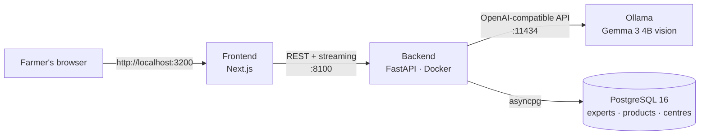

# Smarter Crops AI 🌱

An AI crop doctor for farmers. You describe a crop problem, or upload a photo of a leaf, fruit or field, in **English or Hindi**. The app suggests likely causes and practical steps. It then recommends **agri experts**, **treatments** and **nearby centres** from your own directory. It runs fully on your own machine, powered by **Google Gemma 3**.

> ⚠️ **Disclaimer.** This is a developer project. AI can misidentify crop problems. Always confirm a diagnosis with a local agriculture officer or Krishi Vigyan Kendra before spraying, and always follow the product label.
>
> The data in `backend/data/sample_directory.json` is **SAMPLE data**:
> - Experts and centres are **fictional**.
> - Products use real generic active ingredients, but **doses and prices are indicative only**.

## Features

- 💬 **Farming chat** in English or Hindi, with answers streamed word by word.
- 📷 **Crop photo diagnosis**: describes spots, lesions and pests, then the likely causes.
- 🩺 **Recommendations**, from AI triage (crop, problem type, likely issues, severity) followed by plain-code ranking:
  - 👩‍🌾 **Experts**: plant pathologists, entomologists, soil scientists and more, matched by crop, problem, district and language.
  - 🧪 **Treatments**: generic products that target the suspected problem, with dose, waiting period, safety notes and an organic-only filter. **Nothing is suggested without a specific diagnosis.**
  - 🏢 **Centres**: Krishi Vigyan Kendras, soil-testing labs, plant clinics and input shops near the farmer.
- 🚨 **Pesticide-poisoning safety net**:
  - Phrases like "drank pesticide" or "कीटनाशक पी लिया" trigger an immediate warning to call 108, in English or Hindi.
  - This check is independent of the AI.
- 🌐 **English / हिंदी interface** with one-tap switching.
- 🔒 **Private**: the model runs locally through Ollama.

## Architecture



| Part | Tech | Runs |
|---|---|---|
| Frontend | Next.js 16, React 19, TypeScript | `npm run dev` on port **3200** |
| Backend | FastAPI, Python 3.11, asyncpg, Alembic | **Docker** on port **8100** |
| Database | PostgreSQL 16 | **Docker** (host port 5434) |
| AI model | Gemma 3 4B (vision) through Ollama | Natively on your machine, port **11434** |

## Project structure

```
smarter-crops/
├── docker-compose.yml          # backend + PostgreSQL
├── .env.example                # Docker settings (copy to .env)
├── backend/
│   ├── app/
│   │   ├── main.py             # API routes
│   │   ├── llm_client.py       # talks to the model server
│   │   ├── triage.py           # AI → crop, problem type, issues (+ keyword fallback)
│   │   ├── directory.py        # models + ranking of experts, products, centres
│   │   ├── db.py               # PostgreSQL queries
│   │   ├── models.py           # table definitions (for Alembic)
│   │   ├── prompts.py          # agronomy + triage prompts
│   │   └── safety.py           # pesticide-poisoning detection (EN + HI)
│   ├── alembic/                # database migrations
│   ├── scripts/                # import_data.py, generate_sample_data.py
│   ├── data/                   # sample_directory.json
│   └── tests/
└── frontend/src/
    ├── components/             # ChatApp, Recommendations, Sidebar, Composer…
    └── lib/                    # API client, types, i18n (English / Hindi)
```

---

# 🚀 Quick start

## Step 1: Install the requirements

| Tool | Why | Install (macOS) |
|---|---|---|
| **Docker Desktop** | runs the backend and the database | https://www.docker.com/products/docker-desktop |
| **Ollama** | runs the AI model | `brew install ollama` or https://ollama.com/download |
| **Node.js 20+** | runs the frontend | `brew install node` |
| **Git** | clones the repo | `brew install git` |

**Hardware:** at least 16 GB RAM is recommended, and about 5 GB of free disk for the model.

## Step 2: Clone the repository

```bash
git clone https://github.com/umeshnamdev234/ai-crop-doctor.git
cd ai-crop-doctor
```

## Step 3: Start Ollama and download Gemma 3

```bash
brew services start ollama          # macOS; on Linux: `ollama serve &`
ollama pull gemma3:4b               # ~3.4 GB, one time
ollama run gemma3:4b "What causes yellow leaves in wheat?"   # quick test
```

If the download stops partway, run `ollama pull gemma3:4b` again. It resumes where it left off.

## Step 4: Start the backend (Docker)

```bash
cp .env.example .env               # optional: edit passwords / settings
docker compose up -d --build
```

The first start:
1. Builds the image.
2. Starts PostgreSQL.
3. Runs the migrations.
4. Loads the sample experts, products and centres.
5. Starts the API.

Check that it's healthy:

```bash
docker compose ps
curl http://localhost:8100/api/health
```

All values should be `true`. 📖 Interactive API docs: **http://localhost:8100/docs**

## Step 5: Start the frontend

In a **new terminal**:

```bash
cd frontend
cp .env.example .env.local
npm install
npm run dev
```

Open **http://localhost:3200** 🎉

## Step 6: Try it

1. Tap a suggestion card, or type *"My tomato leaves have brown spots with yellow rings"*.
2. Tap **🌐 भाषा: हिंदी** in the sidebar to switch to Hindi. You can also simply type in Hindi, for example *"गेहूं की पत्तियां पीली हो रही हैं"*.
3. Under the answer, tap **🌿 Experts, treatments & centres**.
4. Choose your state and district, and switch between the **Experts / Treatments / Centres** tabs.
5. Use 📎 to attach a photo of the affected plant.

---

## Everyday commands

| Task | Command |
|---|---|
| Start the backend | `docker compose up -d` |
| Stop the backend | `docker compose down` |
| Backend logs | `docker compose logs -f backend` |
| Rebuild after code changes | `docker compose up -d --build` |
| Start the frontend | `cd frontend && npm run dev` |
| **Reset the database** (deletes all data) | `docker compose down -v` |

## Use your own directory

Import experts, products or centres from CSV. List fields are separated by `;`.

**experts.csv**
```csv
id,name,expert_type,crops,expertise,organisation,qualifications,experience_years,languages,state,district,rating,fee,phone_consult,field_visit,available_days
E001,Jane Doe,Plant Pathologist,tomato;potato,early blight;late blight,District KVK,M.Sc. (Plant Pathology),12,Hindi;Marathi;English,Maharashtra,Pune,4.6,0,yes,no,Mon;Wed;Fri
```
Use these expert types: `Plant Pathologist`, `Entomologist`, `Soil Scientist`, `Agronomist`, `Horticulturist`, `Irrigation Specialist`, `Weed Scientist`, `Organic Farming Expert`, `Agricultural Extension Officer`.

**products.csv**
```csv
id,name,category,active_ingredient,targets,crops,organic,dose,safety_notes,waiting_period_days,price_inr,unit
P001,Mancozeb 75% WP,Fungicide,Mancozeb,early blight;late blight;leaf spot,tomato;potato,no,2–2.5 g per litre of water,Wear gloves and mask,7,450,500 g
```
Use these categories: `Fungicide`, `Bactericide`, `Bio-fungicide`, `Insecticide`, `Bio-insecticide`, `Miticide`, `Herbicide`, `Fertilizer`, `Micronutrient`, `Soil Amendment`, `Organic Manure`.

**centres.csv**
```csv
id,name,centre_type,services,state,district,address,languages,open_days,free_service
C001,KVK Pune,Krishi Vigyan Kendra,crop advisory;plant diagnosis,Maharashtra,Pune,"Address here",Marathi;Hindi,Mon;Tue;Wed;Thu;Fri;Sat,yes
```
Use these centre types: `Krishi Vigyan Kendra`, `Soil Testing Lab`, `Plant Clinic`, `Agri Input Shop`.

**Import:**
```bash
docker compose cp experts.csv backend:/tmp/experts.csv
docker compose exec backend python scripts/import_data.py experts /tmp/experts.csv --replace
```
`--replace` deactivates rows that aren't in your file, such as the sample data. Rows are matched by `id`, so re-importing is safe. Set `SEED_SAMPLE_DATA=false` in `.env` to stop loading the sample data.

---

## Configuration

Set these in the root `.env` file:

| Variable | Default | Purpose |
|---|---|---|
| `LLM_BASE_URL` | `http://host.docker.internal:11434/v1` | Model server. Any OpenAI-compatible API works. |
| `LLM_MODEL` | `gemma3:4b` | Model name. Try `qwen2.5vl:7b` for stronger photo reading. |
| `POSTGRES_PASSWORD` | `change-me-local-only` | Password for the bundled database. **Change it.** |
| `DATABASE_URL` | bundled database | Use an external PostgreSQL instead |
| `CORS_ORIGINS` | `http://localhost:3200,…` | Frontend addresses allowed to call the API |
| `APP_API_KEY` / `ADMIN_API_KEY` | – | Protect all routes / enable admin writes (headers `X-API-Key` / `X-Admin-Key`) |
| `SEED_SAMPLE_DATA` | `true` | Load the sample data into empty tables |
| `API_PORT` / `DB_PORT` | `8100` / `5434` | Ports on your machine |

## API overview

| Method | Endpoint | Description |
|---|---|---|
| GET | `/api/health` | Status of the API, the model and the database |
| POST | `/api/chat` / `/api/chat/stream` | Chat. `reply_language`: `auto`, `en` or `hi` |
| POST | `/api/analyze-image` | Upload one crop photo (multipart) |
| POST | `/api/recommend` | Triage, then experts, products and centres (filters: `state`, `district`, `language`, `organic_only`) |
| GET | `/api/directory/meta` | Counts, states with their districts, and languages |
| GET | `/api/{experts\|products\|centres}` | Browse the directory |
| PUT / DELETE | `/api/{kind}/{id}` | Admin create or update, or deactivate (needs `X-Admin-Key`) |

## Development

```bash
cd backend
uv venv --python 3.11 .venv
uv pip install --python .venv/bin/python -r requirements.txt -r requirements-dev.txt
.venv/bin/python -m pytest -q                      # unit tests: ranking, safety, triage

# change the schema: edit app/models.py, then
.venv/bin/alembic revision --autogenerate -m "describe change"
```

## Troubleshooting

| Problem | Fix |
|---|---|
| `model_available: false` | Run `ollama pull gemma3:4b`, then check `ollama list`. |
| `model_server_reachable: false` | Start Ollama: `brew services start ollama`. |
| "Cannot reach the Smarter Crops API" | Run `docker compose ps`, then `docker compose up -d`. |
| CORS error in the browser | Add the frontend address to `CORS_ORIGINS` in `.env`, then run `docker compose up -d`. |
| Port already in use | Change `API_PORT` / `DB_PORT` in `.env`, or run `npm run dev -- -p 3300` and add that address to `CORS_ORIGINS`. |
| Wrong or vague diagnosis | Upload a clear, close-up photo in daylight, mention the crop and how the problem started, or try a larger model. |

## Known limitations

- Gemma 3 4B is a general model, not trained specifically on crops. It can confuse similar problems, for example whitefly and aphids. Fine-tuning on crop-disease images (such as PlantVillage) is a good next step.
- Product doses in the sample data are indicative. A real deployment must use verified label data.

## Contributing

`main` is protected, so open a pull request from a separate branch. See **[CONTRIBUTING.md](CONTRIBUTING.md)**.

## Model terms

Gemma is provided under the [Gemma Terms of Use](https://ai.google.dev/gemma/terms).
